# HANDOFF — 02-Hardening（节点扩展、规模与发布验证）

> 状态：进行中
> 创建：2026-11-20
> 基线：`736` 个常规测试通过 + `7` 个 gated + `1` 个 `[Explicit]`；`--list-tests` 744；覆盖率总行 77.55%、Services/Commands 85.07%。
> 上一阶段归档：[PLAN/Done/02-Bugfix1/HANDOFF.md](../../Done/02-Bugfix1/HANDOFF.md)
> 边界：本阶段只保留归档 HANDOFF 中仍未完成或新发现的工作；已完成 Round 0–32 内容不再回写。
> 顺序与责任：执行顺序见 §3；缺口严重度见 [STATUS.md](../../STATUS.md) §1.2；责任人：仓库维护者（具体决策人待指派，见 §6.3）。

---

## 1. 本轮定位

Round 32 已关闭大部分 P1/P2：Recipe 校验错误码、CSV 类型推断、Sampler count 分层、SFT 比例拆片、三种 provider 流式、nightly/release/依赖审计。本阶段聚焦：

1. 节点能力扩展：MCP、查询生成、Simulation 隔离与限速。
2. 数据规模：视图索引磁盘化、10M 行筛选/排序、CSV/Parquet 质量基线、Seed 多源。
3. 发布验证：干净机器安装、签名、双进程单实例、依赖锁定决策。
4. 体验与质量：剪贴板/快捷键/分栏/节点分组、本地化、可释放资源与大文件拆分。

工作项统一使用 §5 的逐项证据模板；跨项依赖与待拍板决策见 §6。

---

## 2. 工作池

### 2.1 节点能力（P2）

- [ ] **H-01** Tool Profile MCP（stdio/HTTP）客户端、工具发现、调用与鉴权。
- [ ] **H-02** Tool Profile 共享工具库、版本管理与 LLM 请求侧复用。
- [ ] **H-03** Query Source 随机/模型生成 query、query 去重、权重与元数据。
- [ ] **H-04** Simulation 容器/命名空间级隔离；非 Windows 资源限制；MCP 工具接入（依赖 H-01）。
- [ ] **H-05** Simulation 严格令牌桶限速；工具结果裁剪/摘要策略 UI。
- [ ] **H-06** Simulation 非 OpenAI Chat 流式 delta（当前仅 OpenAI Chat 记录 delta；LLM 节点三家均已支持）。
- [ ] **H-07** Validator 独立失败摘要面板；任意代码沙箱规则（当前 `script` 为 Fluid 布尔表达式）。
- [ ] **H-08** Expression 自定义函数/类型转换；模板错误跳过或写失败文件策略；沙箱/超时。
- [ ] **H-09** Cleaner 坏行跳过与报告；自定义字段/JSONPath 清洗。
- [ ] **H-10** SFT Export DPO/Pretrain 直出；输出路径存在性/可写性提示。
- [ ] **H-11** Sampler 切分内再混洗/保序选项；动态端口变化后旧连线即时失效。
- [ ] **H-12** LLM 多模态消息（README 节点缺口表已列，当前工作池缺失）。

### 2.2 数据规模与格式（P2/P3）

- [ ] **H-13** 视图索引磁盘化，支持 10M 行筛选/排序并记录实测。
- [ ] **H-14** 10M 行质量/转换基线；CSV/Parquet 1M 行质量基线。
- [ ] **H-15** Seed 多文件/目录、节点内过滤/列映射/Limit/Offset。
- [ ] **H-16** Seed 编码/分隔符/CSV 类型选项；HuggingFace/HTTP 数据源。
- [ ] **H-17** Alpaca 多轮转换、额外字段保留策略、ShareGPT `tool_call` 解析失败上报。
- [ ] **H-18** `AttachTools` 空 system 消息确认与修正。
- [ ] **H-19** 运行日志/执行状态/数据集统计摘要本地化（原 2.4 的重复项合并到这里）。

### 2.3 发布与工程化（P1/P2）

- [ ] **H-20** MSIX/Inno 在干净机器安装、启动、文件关联、卸载各一次记录。
- [ ] **H-21** 安装包签名流程与证书 Subject/Publisher 对齐；可选 Azure Trusted Signing。当前 `release.yml` 默认产出未签名包。
- [ ] **H-22** 单实例命名管道双进程端到端自动化测试（gated）。
- [ ] **H-23** 依赖锁定决策：尝试启用 `RestorePackagesWithLockFile` 时与 Debug-only `Avalonia.Diagnostics` 冲突，已撤回；需移除/条件化配置相关包或改用其他锁定方案。
- [ ] **H-24** 处理或明确接受当前传递依赖 High 公告（Snappier、SQLitePCLRaw、Tmds.DBus.Protocol）；升级 Avalonia/SQLite 依赖后复测。
- [ ] **H-25** PR/Issue 模板与贡献指南；PR 测试摘要/注解。
- [ ] **H-26** 跨平台 CI 构建冒烟（Linux/macOS，条件跳过 Windows 专属沙箱测试）。

### 2.4 体验与质量（P3）

- [ ] **H-27** 系统剪贴板/跨实例粘贴；全局快捷键避免文本框焦点冲突。
- [ ] **H-28** 自动布局间距/分组选项；分栏宽度持久化；端口增删/改名/改类型（若产品允许）。
- [ ] **H-29** 自定义预设导出到任意路径；节点分组/注释框。
- [ ] **H-30** 10 个节点面板逐项人工验收；大文件工作台交互验收；画布逐帧性能计时；视觉回归基线。
- [ ] **H-31** CA1001：视图模型与 `RequestRateLimiter`、`AutoFixWriter` 接入 `IDisposable`。
- [ ] **H-32** `async void` 与 `Task.Run` + UI 回调异常边界复核。
- [ ] **H-33** 大文件拆分：`MainWindowViewModel`、`RecipeValidationService`、`RecipeRunner`、`DataWorkbenchViewModel`。
- [ ] **H-34** 设置 schema 版本与迁移、恢复默认设置、日志级别/来源筛选、全局代理/HTTP 配置。
- [ ] **H-35** 崩溃报告保留策略；web_fetch 域名白名单/代理策略；独立威胁模型文档。
- [ ] **H-36** 用户手册/安装排障文档；README 新 UI 截图。
- [ ] **H-40** 错误信息补齐上下文（路径/行号/节点名或 ID/失败原因）；解析错误不得只给消息（02-Bugfix1 DoD 例外转入）。

### 2.5 Backlog（暂不排期）

- [ ] **H-37** 插件化节点、云端执行、Recipe diff/merge、便携模式/设置同步。
- [ ] **H-38** 实时图表（LiveCharts2/OxyPlot）与执行指标面板。
- [ ] **H-39** 自动更新/版本检查；更多界面语言；BenchmarkDotNet 专项基准。

---

## 3. 建议顺序（执行顺序）

> 本节是**执行顺序**；[STATUS.md](../../STATUS.md) §1.2 是**缺口严重度**。两者不一致时：缺口清单看 STATUS，排期看本节。

1. **发布可信度（P1）**：H-23 → H-24；H-21 决策/证书 → H-20；H-22、H-26 可并行。
2. **节点扩展（P2）**：威胁模型 H-35 → H-01 → H-02；H-01 → H-04；H-03 先设计后实现；H-05/H-06/H-07/H-08/H-09/H-10/H-11/H-12 可并行。
3. **数据规模（P2/P3）**：H-13 → H-14；H-15 → H-16；H-17/H-18/H-19 可并行。
4. **体验与质量（P3）**：H-27/H-28/H-29 → H-30；H-31/H-32 → H-33；H-34/H-35/H-36/H-40 可并行。

每批建议 3–5 项，先补测试再改实现；涉及 UI 的项至少补充 Headless 断言并记录手工验收结果。H-35 虽列在 §2.4，但因是 H-01/H-07/H-16 的前置，应在节点批开始前完成威胁模型部分。

---

## 4. 验证命令

```powershell
dotnet build LMTrainingDataStudio2/LMTrainingDataStudio2.slnx -c Release
dotnet test LMTrainingDataStudio2/LMTrainingDataStudio2.slnx -c Release
dotnet format LMTrainingDataStudio2/LMTrainingDataStudio2.slnx --verify-no-changes
```

gated 性能：

```powershell
$env:LMTDS_PERF_TESTS = "1"
$env:LMTDS_PERF_ROWS = "1000000"
$env:LMTDS_PERF_PIPELINE_ROWS = "1000000"
dotnet test LMTrainingDataStudio2/LMTrainingDataStudio2.slnx -c Release --filter "FullyQualifiedName~DatasetPerformanceTests|FullyQualifiedName~PipelinePerformanceTests"
```

真实 provider 冒烟：

```powershell
$env:LMTDS_PROVIDER_SMOKE_KEY = "<key>"
$env:LMTDS_PROVIDER_SMOKE_BASE_URL = "https://api.openai.com/v1"
$env:LMTDS_PROVIDER_SMOKE_MODEL = "gpt-4o-mini"
dotnet test LMTrainingDataStudio2/LMTrainingDataStudio2.slnx -c Release --filter "FullyQualifiedName~ProviderSmokeTests"
```

发布/安装验证（本机或干净机器，按 H-20/H-21 记录）：

```powershell
powershell -ExecutionPolicy Bypass -File scripts/publish-win-x64.ps1
powershell -ExecutionPolicy Bypass -File scripts/package-msix.ps1 -Version 1.0.0.0
powershell -ExecutionPolicy Bypass -File scripts/package-inno.ps1 -Version 1.0.0
```

---

## 5. 逐项证据模板

每关闭一个工作项，必须在本节追加一条验证记录；不接受“已实现/已测试”的口头结论。

### 5.1 工作项字段

| 字段 | 必填 | 说明 |
| --- | --- | --- |
| ID / 标题 | 是 | 使用 H-01…H-40 |
| 类型 | 是 | 功能 / 缺陷 / 验证 / 文档 / 工程 |
| 优先级 | 是 | P0 发布阻塞 / P1 本阶段必做 / P2 可延期 |
| 依赖 | 是 | 无，或前置 ID / 决策 ID |
| 新增模块 | 是 | 新文件/新服务/新测试文件；无则写“无” |
| 修改模块 | 是 | 具体文件或目录 |
| 配置/迁移 | 是 | Recipe schema、Settings schema、预设兼容、数据迁移 |
| 测试 | 是 | 单元 / 集成 / Headless / gated / 手工 |
| 验收 | 是 | 可观察结果 + 阈值 |
| 证据 | 是 | 命令、日志、截图、覆盖率、安装记录 |
| 善后 | 是 | 临时文件、缓存、锁、产物路径与保留 |
| 回滚 | 是 | 关闭开关 / 还原版本 / 删除缓存 / 迁移回退 |

复制以下模板填写：

```markdown
### H-xx 标题
- 类型/优先级：
- 依赖：
- 新增模块：
- 修改模块：
- 配置/迁移：
- 测试：
- 验收：
- 证据：
- 善后：
- 回滚：
```

### 5.2 验证记录表

| 日期 | 项 | 环境 | 命令/步骤 | 结果 | 证据路径 |
| --- | --- | --- | --- | --- | --- |
| 2026-11-21 | 基线复核 | Windows Server 2022 / .NET 9 / Debug | `dotnet build`；`dotnet test --no-build`；`--list-tests` | 0 警告；736 通过 / 7 跳过 / 1 Explicit；744 用例 | 本文件 §5.2 |

环境必须至少记录：OS、CPU/内存、.NET SDK、Debug/Release、是否启用 gated。性能项另记磁盘类型与样本行数。

### 5.3 证据留存与产物清理

- 本地 `artifacts/`（publish、MSIX、Inno、coverage）可整目录删除，发布前由脚本重建；不纳入版本控制。
- `%TEMP%/lmtds-perf*`（`lmtds-perf`、`lmtds-perf-formats`、`lmtds-perf-edit`）由性能测试 `finally` best-effort 删除；进程被中断时手动删除，避免数 GB 残留。
- CI 上传的 test-results、coverage、nightly、release-artifacts 应显式设置 `retention-days`（建议：常规 14 天、nightly 30 天、release 90 天）。
- 发布证据统一放在 `docs/release/<version>/`：安装日志、启动截图、文件关联截图、卸载记录、产物 SHA256、签名状态。
- 运行时清理继续依赖现有机制：溢写目录、检查点配额、执行历史保留、`.lmtds.lock` 释放、索引缓存容量；崩溃报告保留策略由 H-35 补齐。

---

## 6. 依赖图与执行批次

### 6.1 依赖图

```mermaid
flowchart TD
    D1["决策 D1：签名方案"] --> H21["H-21 安装包签名"]
    H21 --> H20["H-20 干净机器安装/关联/卸载"]

    D2["决策 D2：依赖锁定方案"] --> H23["H-23 依赖锁定"]
    H23 --> H24["H-24 High 公告处理/接受"]
    D7["决策 D7：High 公告策略"] --> H24

    D3["决策 D3：跨平台目标"] --> H26["H-26 跨平台 CI"]

    H35["H-35 威胁模型"] --> H01["H-01 Tool Profile MCP"]
    H35 --> H07["H-07 任意代码规则"]
    H35 --> H16["H-16 HF/HTTP 数据源"]
    H01 --> H02["H-02 共享工具库/鉴权"]
    H01 --> H04["H-04 Simulation 隔离/MCP"]

    D5["决策 D5：任意代码策略"] --> H07
    D6["决策 D6：10M 是否发布阻塞"] --> H13["H-13 视图索引磁盘化"]
    D3 --> H03["H-03 Query 生成"]
    H03D["设计：种子/成本/去重"] --> H03

    H13 --> H14["H-14 10M 质量/转换基线"]
    H15["H-15 Seed 多文件/过滤"] --> H16

    D4["决策 D4：端口编辑"] --> H28["H-28 布局/分栏/端口"]
    H27D["DTO 版本化"] --> H27["H-27 系统剪贴板"]

    H27 --> H30["H-30 UI 人工验收"]
    H28 --> H30
    H29["H-29 预设导出/节点分组"] --> H30
    H31["H-31 CA1001"] --> H33["H-33 大文件拆分"]
    H32["H-32 async void 边界"] --> H33
    H34D["设置 schema 决策"] --> H34["H-34 设置迁移/恢复默认"]
```



### 6.2 关键依赖边

| 前置 | 后继 | 原因 |
| --- | --- | --- |
| D1 签名方案 | H-21 | 证书来源、Subject/Publisher 与是否强制签名未定 |
| H-21 签名 | H-20 干净机器安装 | 若发布要求签名包，先有可验证的签名产物 |
| D2 依赖锁定方案 | H-23 | 需先决定是否移除/条件化 Debug-only `Avalonia.Diagnostics` |
| D7 High 公告策略 | H-24 | 先决定升级还是明确接受，再记录复测结果 |
| D3 跨平台目标 | H-26、H-04 | 目标平台决定 CI 矩阵与沙箱能力边界 |
| H-35 威胁模型 | H-01、H-07、H-16 | 三项都扩大网络/代码执行/凭据边界 |
| H-01 MCP 客户端 | H-02、H-04 | 共享工具库与 Simulation MCP 复用同一客户端 |
| D5 任意代码策略 | H-07 | 保持 Fluid 还是引入沙箱，决定实现范围 |
| H-03 设计（种子/成本/去重） | H-03 实现 | 模型生成 query 会产生费用，需先定上限与可复现性 |
| D6 10M 发布阻塞 | H-13、H-14 | 决定是否投入磁盘索引与 10M 实测 |
| H-13 磁盘索引 | H-14 10M 基线 | 没有磁盘索引无法稳定支持 10M 筛选/排序 |
| H-15 Seed 多文件 | H-16 HF/HTTP | 多源读取抽象应先于远程数据源 |
| D4 端口编辑 | H-28、H-11 | 若端口只读，则只做失效检测，不做增删改 |
| H-27 DTO 版本化 | H-27 跨实例粘贴 | 跨实例需要稳定的序列化契约 |
| H-27/H-28/H-29 | H-30 UI 人工验收 | 人工验收应在相关 UI 冻结后执行 |
| H-31/H-32 | H-33 大文件拆分 | 先接线释放与异常边界，再拆文件 |
| 设置 schema 决策 | H-34 | 先定是否引入版本化/迁移，再实现恢复默认与日志筛选 |

### 6.3 待拍板决策

| ID | 决策 | 选项/建议 | 影响项 | 决策人 |
| --- | --- | --- | --- | --- |
| D1 | 安装包签名 | 本地证书 / Azure Trusted Signing；release 是否强制签名 | H-20、H-21 | 待指派 |
| D2 | 依赖锁定 | 移除或条件化 `Avalonia.Diagnostics` 后启用 lock；或明确不锁定 | H-23、H-24 | 待指派 |
| D3 | 跨平台目标 | 仅 Windows / 构建冒烟 / 完整支持 | H-26、H-04 | 待指派 |
| D4 | 端口编辑 | 只读 + 失效检测 / 允许增删改名改类型 | H-11、H-28 | 待指派 |
| D5 | 任意代码规则 | 保持 Fluid / 引入受限沙箱 | H-07 | 待指派 |
| D6 | 10M 是否发布阻塞 | 发布前实测 / 入口与文档即可 | H-13、H-14 | 待指派 |
| D7 | High 依赖公告 | 升级 Avalonia/SQLite / 明确接受并记录 | H-24 | 待指派 |

### 6.4 并行批次

| 批次 | 工作项 | 前置 |
| --- | --- | --- |
| A 发布可信度 | H-20…H-26 | D1、D2、D3、D7 |
| B 节点扩展 | H-01…H-12；H-35 提前完成威胁模型部分 | D5；H-35 |
| C 数据规模 | H-13…H-19 | D6；H-13 → H-14；H-15 → H-16 |
| D 体验与质量 | H-27…H-36、H-40 | D4；H-31/H-32 → H-33；H-27/H-28/H-29 → H-30 |

---

## 7. 验收标准

- `dotnet build` 0 警告、0 错误；`dotnet test` 全绿；`dotnet format --verify-no-changes` 通过。
- 每个新增/修改核心逻辑有成功、失败与边界测试；每个关闭项在 §5.2 有验证记录与环境信息。
- UI 入口真实可用，新增控件有 Headless 或手工验收记录；手工记录必须写明日期、步骤与结果。
- 文件写入保持临时文件 + 原子替换；多文件拆片失败不留下半成品。
- README / STATUS / HANDOFF / CHANGELOG 与代码一致；不得保留过期计数、矛盾状态或未标注的历史值。
- 发布项至少有一份干净机器安装、启动、文件关联、卸载记录；签名状态与产物 SHA256 一并归档。
- 产物按 §5.3 清理/留存；不得遗留溢写目录、检查点、锁文件或数 GB 性能样本。
- 阻塞决策在实现前记录到 §6.3；未完成项必须写明原因与后续入口。
- 每个工作项关闭时在 §5.2 追加证据，不接受口头“已完成”。
